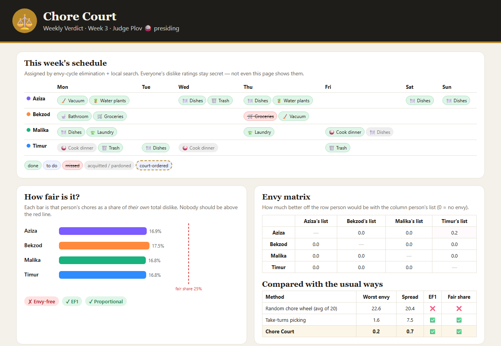
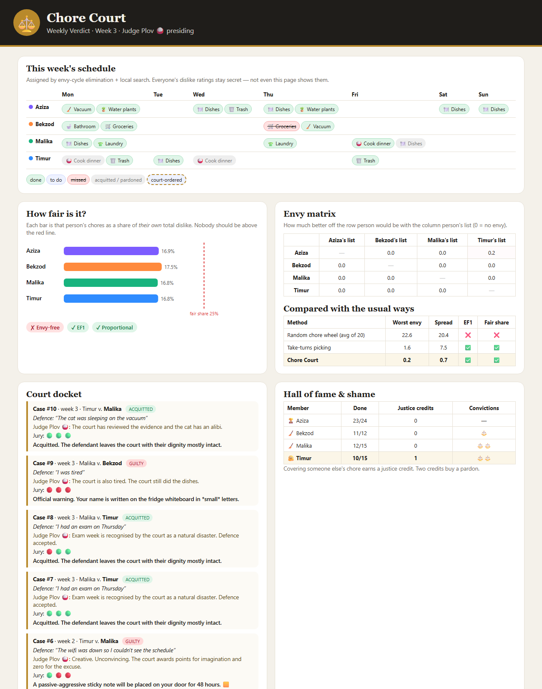

# ⚖️ Chore Court

**Fair chores. Real consequences.**

Chore Court splits household chores using **fair-division algorithms from game theory**,
so nobody can honestly say "I always get the worst jobs". Then it enforces the schedule with
increasingly passive-aggressive reminders, jury trials for excuses, and
**the Honourable Judge Plov 🍚**.

[](https://github.com/GGmanforeal/chore-court/actions/workflows/ci.yml)




## The problem

Every family and every shared flat has the same argument. A chore wheel is "equal", but it
isn't *fair*: if you hate washing dishes and your brother doesn't mind, giving you both the
same number of dishes is the worst possible split. What people actually want is:

> *Nobody would rather swap their whole list with someone else's.*

Economists call this **envy-freeness**, and there are algorithms for it.

## How it works

1. **Everyone secretly rates each chore** from 0 ("don't mind") to 10 ("pure suffering").
   The ratings are never shown to anyone: not in the bot, not in the report.
2. Each chore occurrence costs `(rating + 1) × minutes`. Every person's costs are **normalised
   to 100**, so everyone has the same "budget of dislike". That makes the split fair
   without anyone having to argue that they suffer more than someone else.
3. The chores are split by fair-division algorithms:

| Algorithm | Guarantee | Used when |
|---|---|---|
| **Exact search** | Among all EF1 splits, minimises the worst-off person's pain, then the total pain | small households (≤ 60,000 possible splits) |
| **Envy-cycle elimination** with top-trading cycles ([Bhaskar, Sricharan & Vaish, 2020](https://arxiv.org/abs/2012.06788)) | always **EF1** | everything else, then… |
| **Local search** | only accepts moves/swaps that keep EF1 *and* lower the worst pain | …to polish the result |
| Round-robin ("take turns picking") | EF1 | baseline for comparison |
| Random chore wheel | nothing | baseline for comparison |

- **Envy-free (EF):** nobody prefers anyone else's list.
- **EF1, envy-free up to one chore:** any envy disappears if you remove one chore from
  the envious person's list. Full EF can be impossible: with one awful chore and two people,
  somebody has to do it. EF1 is always achievable, and it's what the algorithm guarantees.
- **Proportional:** everyone's pain is at most their fair share, 100 / n.

**Results on the demo family** (4 people, 22 chores a week):

| Method | Worst envy | Spread of pain | EF1 | Everyone ≤ fair share |
|---|---|---|---|---|
| Random chore wheel (average of 20) | 22.6 | 20.4 | ❌ | ❌ |
| Take turns picking | 1.6 | 7.5 | ✅ | ✅ |
| **Chore Court** | **0.2** | **0.7** | ✅ | ✅ |

Because people hate *different* chores, everyone ends up at about **17% of their own dislike budget**,
well under the 25% fair share. Good fair division makes everybody better off, not just equal.

## The court

Missed a chore? The reminders escalate in six steps:

> 🙂 Friendly reminder: Dishes is on your list today, Timur.
> 😐 Timur. Dishes. It's been a day. I'm not mad, I'm just disappointed.
> 😑 Day 2 of 'dishes' being undone. It has started forming its own government.
> 📜 Timur, this is your final notice before Judge Plov 🍚 gets involved. 'Dishes' has hired a lawyer.

Then someone files a case. The defendant pleads, Judge Plov comments on the excuse, and
**the rest of the household votes as the jury**:

```
⚖️  Case #4: Bekzod v. Timur — “The cat was sleeping on the vacuum”
   Judge Plov 🍚: The court has reviewed the evidence and the cat has an alibi.
⚖️  Case #2: Aziza v. Timur — “There was a football match”
   Judge Plov 🍚: So the defendant chose entertainment over civic duty. Noted. Strongly noted.
   Verdict: GUILTY. A passive-aggressive sticky note will be placed on your door for 48 hours. 🟨
```

- **Excuses** are recognised in English, Uzbek and Russian. *Valid* excuses (ill, exams, family
  events), *weak* ones (forgot, tired, football) and *absurd* ones (the cat, aliens, the wifi) each get
  their own comment. A tied jury is broken by the judge based on the excuse.
- **Sentences escalate** with repeat offences within 4 weeks: an official warning, a sticky
  note, community service (the chore *everyone else* hates most, added to next week),
  double community service, and finally "Buvi (grandma) will be informed. 👵"
- **Justice credits:** do someone else's chore and you earn a credit. Two credits buy a pardon.
- **Rules of procedure:** you can't accuse yourself, you can't vote in your own trial, there is no
  double jeopardy, and a chore that was done can't be taken to court.



## Run it on Windows

You need [Python 3.10+](https://www.python.org/downloads/). There is nothing to install.

```bash
git clone https://github.com/GGmanforeal/chore-court.git
cd chore-court
python -m chorecourt demo
```

This simulates a 4-person family for 3 weeks, with trials, and opens the Weekly Verdict
in your browser. You can also double-click **`run-demo.bat`**.

### Use it for your real household

```bash
python -m chorecourt init Aziza Bekzod Malika Timur
python -m chorecourt rate Aziza dishes=3 bathroom=9 cook=1      # each person, in private
python -m chorecourt assign                                     # fair schedule for the week
python -m chorecourt show
python -m chorecourt done 12 --by Malika                        # covering = +1 justice credit
python -m chorecourt accuse 7 --by Aziza
python -m chorecourt plead 1 "I had an exam"
python -m chorecourt vote 1 Malika innocent
python -m chorecourt report                                     # the Weekly Verdict page
```

Everything is stored in a readable `household.json`.

### Telegram bot for the family group (optional)

```bash
set CHORECOURT_BOT_TOKEN=paste-your-token-from-BotFather
python -m chorecourt bot
```

Add the bot to your family group. Commands: `/join`, `/rate dishes 8`, `/assign`, `/today`,
`/done 12`, `/accuse 12`, `/plead 3 I had an exam`, `/guilty 3`, `/innocent 3`, `/fairness`.
The token is read from the environment only and is never saved.

## Tests

```bash
python -m unittest discover -s tests -t . -v
```

The 25 tests include **property-based checks of the theorems**:

- Round-robin, envy-cycle elimination and the full pipeline are EF1 on hundreds of random households.
- The exact solver is cross-checked against brute force.
- Local search never breaks EF1 and never makes things worse.
- Chore Court never has more envy than a random wheel.

They also cover the court rules, sentencing escalation, the bot conversation, CLI round-trips
and HTML escaping in the report. CI runs on Windows and Linux.

## Project structure

```
chorecourt/fairness.py   fair-division algorithms + EF / EF1 / PROP checks
chorecourt/household.py  members, chores, secret ratings, weekly schedule (JSON)
chorecourt/court.py      reminders, excuses, trials, sentences, pardons
chorecourt/report.py     the Weekly Verdict (self-contained HTML + SVG)
chorecourt/bot.py        Telegram bot (urllib long polling)
chorecourt/demo.py       simulated family
```

About 1,150 lines of Python, **standard library only**.

## Credits

Made by **Rahimjon Xasanov** ([@GGmanforeal](https://github.com/GGmanforeal)). MIT licensed.
The algorithmic ideas come from the fair-division literature, especially Bhaskar, Sricharan & Vaish,
*"On Approximate Envy-Freeness for Indivisible Chores and Mixed Resources"* (APPROX 2021).
Judge Plov is fictional, but he is always right.
